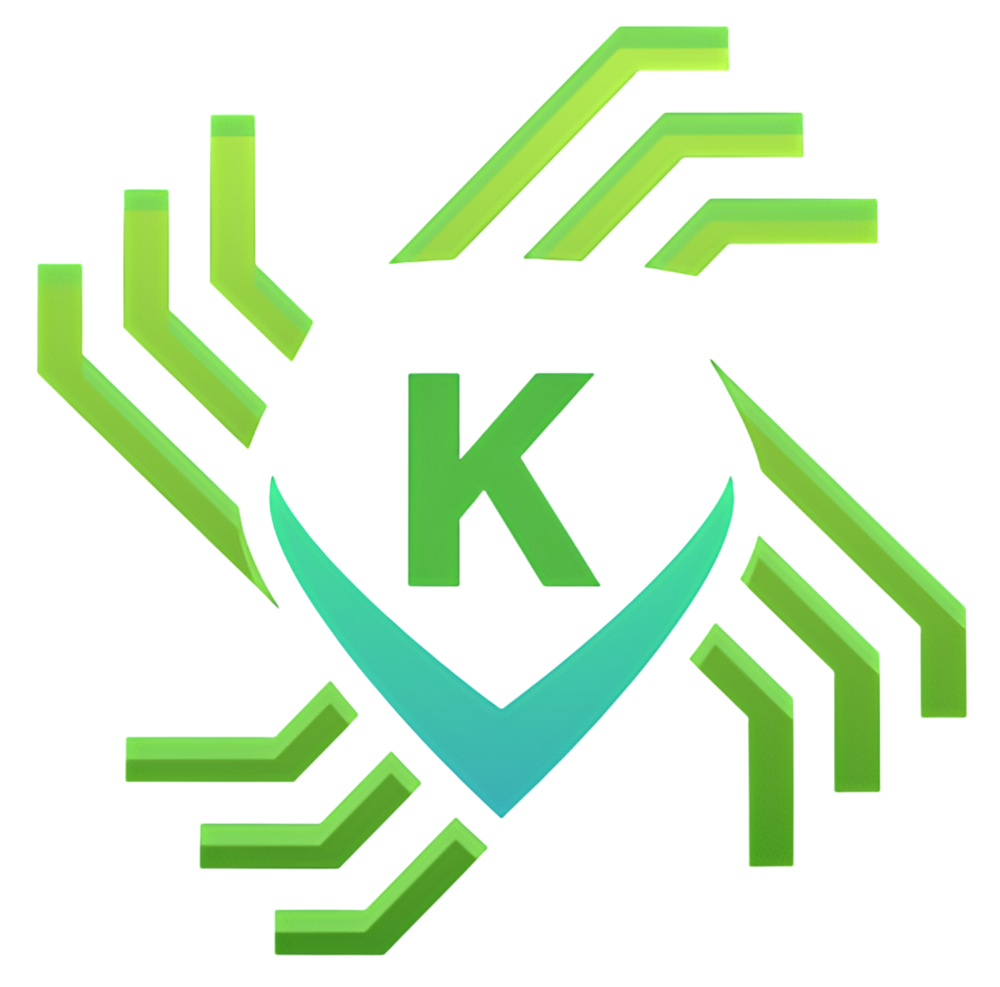

<div align="center">
  
  
  # 🛡️ Khan TrapMind
  **Next-Gen AI-Powered Endpoint Defense & Threat Interceptor**

  [](https://github.com/iamthearafatkhan/khan-trapmind/releases)
  [](https://www.python.org/)
  [](https://opensource.org/licenses/MIT)
  []()
  
  <br>
  
  [](https://github.com/iamthearafatkhan/khan-trapmind/releases/latest)
</div>

---

## 📖 Introduction

**Khan TrapMind** is a free, lightweight, and powerful Endpoint Detection and Response (EDR) tool designed for modern threats. Unlike traditional antivirus software that relies solely on old signatures, TrapMind uses a multi-layered approach combining **Machine Learning (AI), Behavioral Analysis, and Deception Technology (Honeytokens)** to protect your Windows PC.

Built with Python and PyQt6, it provides a premium, dark-themed dashboard that rivals paid enterprise security solutions—completely free of charge.

## ✨ Key Features

*   🧠 **Dual AI Malware Detection:** Uses **TabNet** (PE structural analysis) and **MalConv** (raw byte analysis) to catch zero-day malware before it runs.
*   ⚡ **Real-Time Protection:** Monitors your entire user profile instantly. Suspicious files are instantly quarantined.
*   🍯 **AI Honeytokens (Deception Tech):** Drops fake, highly attractive files (like `admin_passwords.txt`) in your system. If malware or an AI Agent tries to read them, TrapMind catches them in the act.
*   🕵️ **Behavioral Process Monitor:** Instantly kills malicious scripts (like drive-by downloads spawning a hidden PowerShell) and blocks cookie theft attempts.
*   🔒 **Windows Event Log Monitor:** Detects brute-force login attempts and unauthorized admin account creation in real-time.
*   📱 **Mobile Web Dashboard:** Monitor your PC's security status and live threats from your phone via `http://YOUR_IP:8000`.
*   🔄 **Cloud Threat Intelligence:** Automatically fetches the latest YARA rules from the cloud to stay updated against new threats.

## 🚀 Installation & Usage

### Option 1: Standalone Executable (Recommended for Users)
1. Go to the [**Releases Page**](https://github.com/iamthearafatkhan/khan-trapmind/releases).
2. Download the latest `Khan_TrapMind.exe`.
3. Double-click to run. **Note:** Windows will ask for Administrator privileges. Click **Yes** (this is required to read Windows Security Logs).

### Option 2: Run from Source (For Developers)
```bash
# 1. Clone the repository
git clone https://github.com/iamthearafatkhan/khan-trapmind.git
cd khan-trapmind

# 2. Install dependencies
pip install -r requirements.txt

# 3. Run the application (as Administrator)
python main.py
```

## 🛡️ How to Use
*   **System Tray:** Closing the window (X) hides the app in your system tray (bottom right). Right-click the tray icon to exit.

*   **Mobile Dashboard:** Open the URL shown in the top-right corner on your phone (connected to the same Wi-Fi) to monitor your PC remotely.

*   **Quarantine:** If a threat is found, it is moved to a secure vault. You can view and permanently delete it via the "Open Quarantine" button.

## 🚫 Limitations (The Honest Truth)
No software is 100% invincible. TrapMind is highly effective, but you should know its limits:

1.   **Kernel-Level Attacks:** TrapMind runs in User-Mode (Ring 3). It cannot stop an attacker who already has full Administrator/Kernel access (Ring 0).

2.   **Memory-Only Threats:** Advanced fileless malware that runs purely in RAM without touching the disk (though TrapMind will kill the spawned processes and flag CPU anomalies).

3.   **Phishing:** TrapMind does not scan your emails or browser text; it protects the endpoint (the device).

## 📊 Outcome
With Khan TrapMind running, you have an enterprise-grade, multi-layered shield that actively detects, quarantines, and analyzes threats. It turns any standard Windows PC into a proactive security environment.

## 👨‍💻 Credits
---
<div align="center"> <i>Built with ❤️ by <a href="https://github.com/iamthearafatkhan">Arafat Khan</a></i> </div>

**If you find this project helpful, please consider giving it a ⭐ on GitHub!**